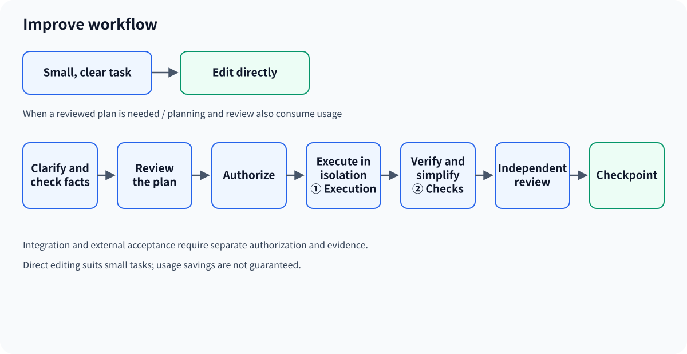

[简体中文](README.zh-CN.md)

<p align="center"></p>

# Codex Base

Codex Base combines adapted community skills with our team's workflow and environment integration for Codex. It aims to reduce repeated context gathering, drift from settled decisions, and rework caused by over-engineering during long coding tasks.

> [!WARNING]
> This is the agent harness—the instructions, tools, and workflows around Codex—that my team uses and shares publicly. It is not a product aimed at most users. AI and Codex evolve quickly; this repository will remain `unstable` and may require substantial additional configuration.
>
> We share it so others can help improve the engineering behind the harness. We believe working together can help our teams adopt useful advances sooner, improve productivity, and build more advanced products. We warmly welcome valuable issues and PRs; please take time to understand the project's intent and respect its documented conventions.
>
> **Finish existing plans before updating.** Codex Base changes quickly, and we do not currently guarantee compatibility across versions. Plans and execution state created with an older version may no longer work after an update. Whenever possible, complete implementation, review, integration, and acceptance before updating Codex Base.
>
> Execution hosts are currently supported only on Linux x64. The desktop client may use a different operating system when it connects to that host. Request macOS or Windows execution-host support through a [new issue](https://github.com/bioinformatist/codex-base/issues/new).

[](https://github.com/bioinformatist/codex-base/actions/workflows/ci.yml)
[](LICENSE)

[Quick start](#quick-start) · [First workflow](#first-workflow) · [Updates](#reload-after-an-update) · [Configuration reference](docs/configuration.md)

## What we've done

Our Improve workflow builds on the audit and planning foundations from [shadcn's Improve](https://github.com/shadcn/improve). We adapt selected skills from [Matt Pocock](https://github.com/mattpocock/skills) for requirements clarification, debugging, testing, design, retrospectives, prototypes, and agent guidance. We also adapt and integrate [Ponytail](https://github.com/DietrichGebert/ponytail) for implementation, comprehensive change review, repository audits, and shortcut debt; [stop-slop](https://github.com/hardikpandya/stop-slop) for prose editing; and the [Playwright CLI skill](https://github.com/microsoft/playwright-cli) for browser work.

Our work focuses on adapting these foundations to Codex, extending and connecting the planning, execution, and review workflow, adding documentation and bounded public-X research support, and maintaining the plugin and Nix/Home Manager environment. In this setup:

- Formal planning resolves material choices and produces a complete plan in chat. An authorized implementation phase can then persist it and delegate bounded work.
- Implementation consults current documentation; an isolated executor verifies and simplifies each changing step. Reviews and checkpoints identify the candidate they cover so work can be resumed and assessed.
- Focused automatic skills vet measured benchmarks, trace change impact, and plan deprecation cutovers; explicit invocation is also available. They adapt Lauren Tan’s pstack and Addy Osmani’s agent-skills methods.
- Shared skills cover documentation lookup, debugging, testing, design, and prose review. The [capability catalog](docs/capabilities.md) lists their triggers and installation requirements.
- ADHX reads relevant public X post URLs supplied by users or found through bounded web research; it is not an X search service, and long-form Article content may be incomplete.

The [credits and licenses](docs/credits.md) describe the upstream contributions and our adaptations; [source records](vendor/sources.json) identify the included paths and pinned revisions.



See the [workflow guide](docs/workflow.md#overview) for the main path, [① execution lanes](docs/workflow.md#execution), and [② verification](docs/workflow.md#verification).

Planning and review also consume usage, so small, clear edits are usually better handled directly. Codex Base does not promise fewer tokens or lower cost for every task.

## Quick start

> [!NOTE]
> If setup feels daunting but you want a full Nix / Home Manager environment similar to mine (the repository owner's), hand this README to Codex and ask it to help you set things up :)

### 1. Identify the execution host

Use Codex CLI or Codex in the ChatGPT desktop app; the IDE extension does not support plugins. This repository supports Codex workflows, not general Chat or Work conversations. See the official [plugin guide](https://learn.chatgpt.com/docs/plugins).

Install and configure Codex Base on the machine that executes the task:

| Client | Execution host and Codex runtime |
|---|---|
| Codex CLI | The machine running `codex`; it uses the CLI installation on `PATH`. |
| Local desktop chat | The desktop machine; the app uses its bundled Codex runtime, which can differ from the system CLI. |
| Desktop over SSH | The selected remote host; the desktop client starts Codex App Server there. The remote login shell must find `codex` on `PATH`. |

For SSH setup, follow the official [connection guide](https://learn.chatgpt.com/docs/remote-connections#connect-to-an-ssh-host). Installing on the desktop client alone does not configure the remote host.

Linux x64 execution needs Bash, GNU coreutils, Git, GNU sed, jq, Codex, and Worktrunk (`wt`) on `PATH`. Install the matching precompiled Codex Base runtime for Improve. The static binaries need no Python, Cargo, Nix, or local compilation. Nix/Home Manager supplies these binaries and the host tools. WSL2 can provide a Linux x64 execution host; keep repositories in its Linux filesystem (for example `~/src`).

<a id="choose-an-installation"></a>

### 2. Choose an installation

Choose the plugin to add the portable workflow to an existing Codex setup, or Home Manager to manage the full Linux environment.

| Provided or configured | Codex plugin | Nix / Home Manager full environment |
|---|---|---|
| Engineering skills | Namespaced, such as `$codex-base:improve` | Unnamespaced, such as `$improve` |
| Improve CLI | Precompiled `codex-improve` with host Git, Codex and `wt` | Packaged `codex-improve` plus `wt` |
| Global guidance and GitHub MCP | No | Yes |
| Context7 documentation services | Anonymous HTTP defaults | Local anonymous Context7, and optional per-user authentication |
| Codex, Code Mode Host, Node, Playwright CLI | No | Default Codex package with Code Mode Host, plus pinned Node and Playwright CLI; Codex package can be replaced |

#### Codex plugin

Run on the execution host:

```console
codex plugin marketplace add https://github.com/bioinformatist/codex-base
codex plugin add codex-base@bioinformatist-codex
codex plugin list --marketplace bioinformatist-codex
```

The output should show `codex-base@bioinformatist-codex` installed and enabled. The plugin does not install Codex, host packages, or global configuration.

For Improve, download the `codex-base-runtime-x86_64-unknown-linux-musl` artifact from a successful `plugin-portability` job in the matching source tree's [PR workflow run](https://github.com/bioinformatist/codex-base/actions/workflows/ci.yml). Unzip the artifact into a directory, then verify and install its archive:

```console
cd downloaded-artifact
sha256sum --check SHA256SUMS
cat metadata.json
mkdir -p "$runtime_prefix"
tar -xzf codex-base-runtime-x86_64-unknown-linux-musl.tar.gz -C "$runtime_prefix"
export PATH="$runtime_prefix/bin:$PATH"
codex-improve --help
```

Set `runtime_prefix` to your chosen installation prefix first. Check that `metadata.json` has `distribution=ci`, the expected `sourceCommit` and `sourceTree`, and target `x86_64-unknown-linux-musl`. Install the plugin from that same source revision. `local-smoke` metadata is only for local installation checks. The acceptance handoff records the actual run, artifact and digest; there is no automatic Release download.

#### Nix / Home Manager

Add this input to your existing `flake.nix`:

```nix
inputs.codex-base = {
  url = "github:bioinformatist/codex-base";
  inputs.nixpkgs.follows = "nixpkgs";
};
```

In your Home Manager module, with `inputs` in scope:

```nix
{
  imports = [ inputs.codex-base.homeManagerModules.default ];
  programs.codexBase.enable = true;
}
```

Activate the consuming Home Manager or NixOS configuration using your usual deployment procedure. This route provides the skills, runners, and managed configuration; a separate plugin installation is unnecessary.

The full Nix / Home Manager environment currently pins Codex 0.165.0 and Code Mode Host.
This describes the default package; to supply another CLI package, see [Codex package selection](docs/configuration.md#codex-package-selection).

### 3. Configure and verify

Home Manager supplies the runtime defaults. For a plugin-only installation, follow [Native Codex configuration](docs/configuration.md#native-codex-configuration) to request the planning capabilities and configure Code Mode if its companion host is available. Then follow [Reload after an update](#reload-after-an-update).

Both installations provide Context7 for public documentation lookup. The plugin uses an anonymous HTTP endpoint; Home Manager uses local Context7. Start with these anonymous defaults. Optional user-owned authentication and its verification are covered in [Context7 authentication](docs/configuration.md#context7-authentication). Native Codex configuration overrides same-name plugin defaults. Send only focused public lookup terms to Context7, never secrets, private code, full prompts, or non-public internal content.

On the execution host, check the registered services:

```console
codex mcp list --json
```

A plugin-only installation with no native overrides should list `context7`, with no `context7_auth`. Registration does not prove that a service or credential works.

Start a new Codex task and try a harmless skill invocation:

```text
Use $codex-base:stop-slop to tighten this sentence without changing its facts: "At this point in time, the test suite contains three tests."
```

With Home Manager, use `$stop-slop` without the plugin prefix. This checks skill discovery; formal planning has the additional requirements below.

## First workflow

These instructions apply to **both installation methods**. A Codex task means one chat: a CLI conversation or, on desktop, a Codex chat under a project in the app sidebar. Entering Plan Mode or invoking `$improve` within it does not create another task.

### Start with the right model

The managed default is `gpt-6.1-sol` with `medium` reasoning; Plan Mode uses `high`. Formal Improve planning needs a capable Astra Plan Mode session. Check the [planning prerequisites](docs/workflow.md#overview) and [configuration](docs/configuration.md#model-choice) before starting.

### Plan, then authorize implementation

Enter built-in Plan Mode with `/plan` or Shift+Tab in the CLI; the desktop composer also supports [`/plan`](https://learn.chatgpt.com/docs/reference/slash-commands). Then invoke Improve using the name for your installation:

| Installation | Prompt |
|---|---|
| Plugin | `$codex-base:improve plan <request>` |
| Home Manager | `$improve plan <request>` |

Improve discovers facts, asks about material unresolved choices, and presents the complete replacement plan in chat. Planning creates no plan, questionnaire, handoff, or temporary files. Once you accept the plan, authorize implementation in Default Mode; that later writable phase can persist the plan and execute it.

The plan selects [verification](docs/workflow.md#verification) for the task, including necessary tests and independent review.

Default Mode implementation, audits, and routine lifecycle bookkeeping do not require a new formal-planning workflow. Use individual skills directly when a task does not need formal planning; see the [capability catalog](docs/capabilities.md).

## Reload after an update

See [update compatibility](docs/updating.md#applying-an-update) before reloading.

First [update the installed plugin or activate the consuming Nix configuration](docs/updating.md#applying-an-update); restarting alone does not fetch new files. Wait for affected tasks to finish, then reload the runtime that executes them:

| Client | Reload procedure |
|---|---|
| CLI | Exit and relaunch Codex. |
| Local desktop | Fully quit and reopen the ChatGPT desktop app, then start a new Codex chat. Closing only the window does not quit the app. Update the app separately when needed: its [bundled Codex can differ from the system CLI](https://learn.chatgpt.com/docs/reference/troubleshooting#feature-is-working-in-the-codex-cli-but-not-in-the-chatgpt-desktop-app). |
| Desktop over SSH | After updating the remote installation, restart the host's backend through **Settings → Connections → SSH**, following the official [connection guide](https://learn.chatgpt.com/docs/remote-connections#connect-to-an-ssh-host), then start a new chat. |

For SSH, verify the running remote Codex App Server; `codex --version` only reports a newly invoked binary. Restarting the desktop client or creating a new chat does not prove that remote process restarted. Resuming an existing chat preserves its history.

## Learn and contribute

- [Workflow guide](docs/workflow.md)
- [Configuration, authentication, and troubleshooting](docs/configuration.md)
- [Detailed capability catalog](docs/capabilities.md)
- [Contributing](CONTRIBUTING.md), [architecture](docs/architecture.md), and [updating](docs/updating.md)
- [Credits and upstream licenses](docs/credits.md)
- [Changelog](CHANGELOG.md)
- [MIT License](LICENSE)
