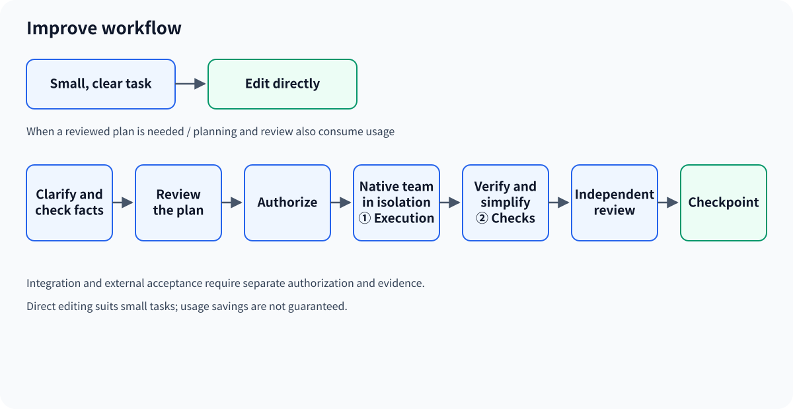
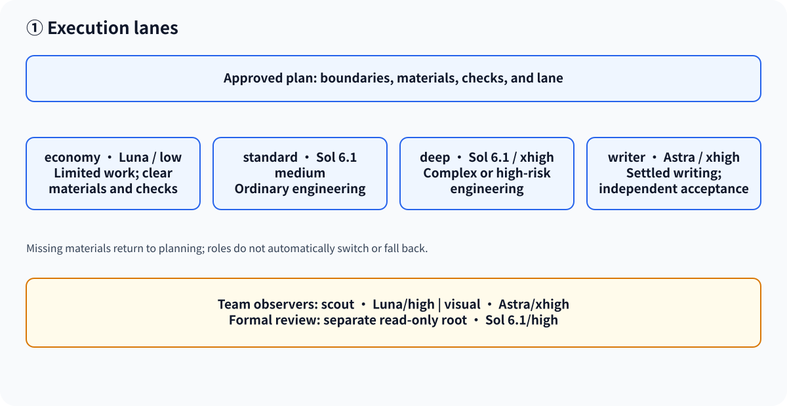
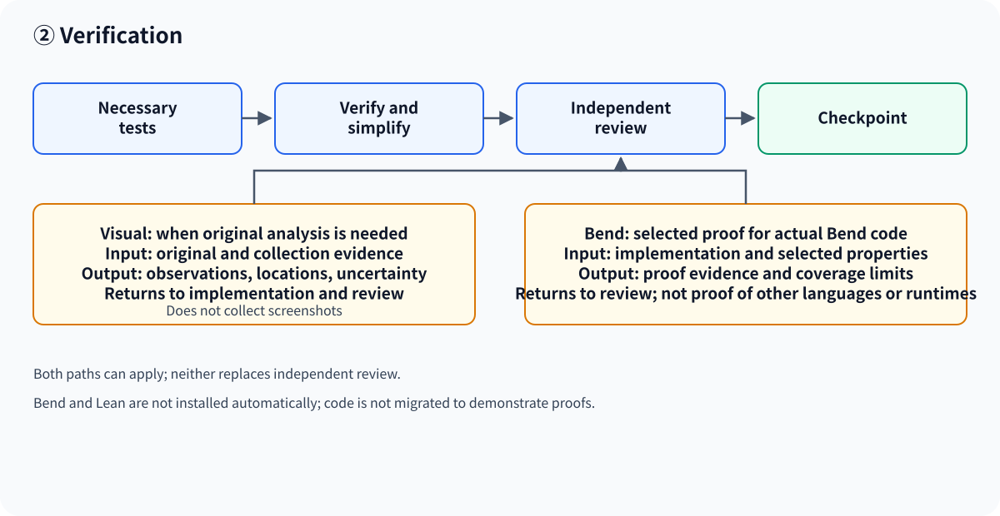

[简体中文](workflow.zh-CN.md) · [README](../README.md)

# Improve workflow

## Overview

Improve is a planning and execution coordination workflow. For a small, clear task, edit directly. For work that needs a reviewed plan, the main path is:

**Clarify and check facts → Review the plan → Authorize → Execute in isolation → Verify and simplify → Independent review → Checkpoint**

A checkpoint is a reviewed, saved commit. Integration and external acceptance are separate steps and require their own authorization and evidence. Planning and review consume usage; they do not guarantee fewer tokens or lower cost.

[① Execution lanes](#execution) · [② Verification](#verification)

Formal planning requires Astra in built-in Plan Mode, with native context management and structured questions actually callable in the current session. An independent Astra plan reviewer may use read-only Default Mode, but also needs both capabilities. A model name, configuration flag, Plan Mode label, or context-window size alone does not establish availability. High reasoning and Code Mode are recommendations. See [configuration](configuration.md#native-codex-configuration) for setup and troubleshooting.

Improve resolves material choices and presents a complete plan in chat without writing files. After the user accepts it and authorizes implementation, a writable phase can save the plan and execute it. Implementation, audits, and routine lifecycle bookkeeping do not require a new formal plan.

## ① Execution lanes

An execution lane selects the implementation root's model and effort. The
connected client reads canonical roles and keeps the same loaded root through
continuation and revision. Native tools own team dispatch, messages and waits;
there is no model fallback or coordinator root timer. Astra is the model used
for writer and visual.

| Lane | Model / effort | Use when |
|---|---|---|
| economy | Luna / low | A limited task has clear boundaries, materials, and checks. |
| standard | Sol 6.1 / medium | Ordinary engineering work. |
| deep | Sol 6.1 / xhigh | Complex or high-risk engineering work. |
| writer | Astra / xhigh | Writing has settled materials and conclusions and can be accepted independently. |

Writer needs settled materials; missing facts return to planning. Atomic code
and documentation stay in one engineering task. Scout (Luna/high) and visual
(Astra/xhigh) observe by responsibility within the implementation team's shared
workspace-write authority. They are not separate read-only sandboxes. Formal
reviewer (Sol 6.1/high) starts in a fresh local read-only root; its descendants
inherit that boundary, with verified read-only external tools and image access.
Implementation shares 300k native rollout units; review has its own 100k.
Reminders are 150k/75k/30k and 50k/25k/10k remaining respectively. These are native
accounting units, not context length or a strict zero-overshoot promise.
See [architecture](architecture.md#executor-routing) and [new-task usage](improve-lifecycle.md).

Examples:

- **Ordinary engineering:** a reviewed plan selects standard, identifies paths and checks, and sends the result to independent review.
- **Settled writing:** a plan supplies writer with facts, conclusions, audience, terminology, paths, and acceptance; missing material goes back to planning.
- **Original image analysis:** visual receives the original and collection evidence, then returns observations with locations and uncertainty to the executor and reviewer.

## ② Verification

The plan chooses verification separately from the execution lane. Run the tests needed for the change, verify and simplify each implementation step, and independently review the candidate. A review and checkpoint bind to the candidate and required evidence; changed inputs can invalidate approval. Freeze every descendant and background terminal before capture; keep the implementation root loaded during independent review. Lost connection or root stops the task without a new budget. Permission to review does not itself authorize a commit, integration, push, or publication.

Two conditional paths can both apply:

- **Visual:** when original-image analysis is needed, provide the original and collection evidence. The observing role returns observations with locations and uncertainty for implementation and review. It does not collect screenshots or replace independent review.
- **Bend:** Bend 2 is a language and tool for formal proofs of selected properties. When the plan selects proof work for an actual Bend implementation, `bend-proof` supplies evidence for specified properties and coverage limits to review. It supplements tests and independent review; it does not prove Rust, compilers, binaries, or the runtime environment. Neither installation automatically installs Bend or Lean, and the workflow does not migrate code to Bend to demonstrate proof capability.
