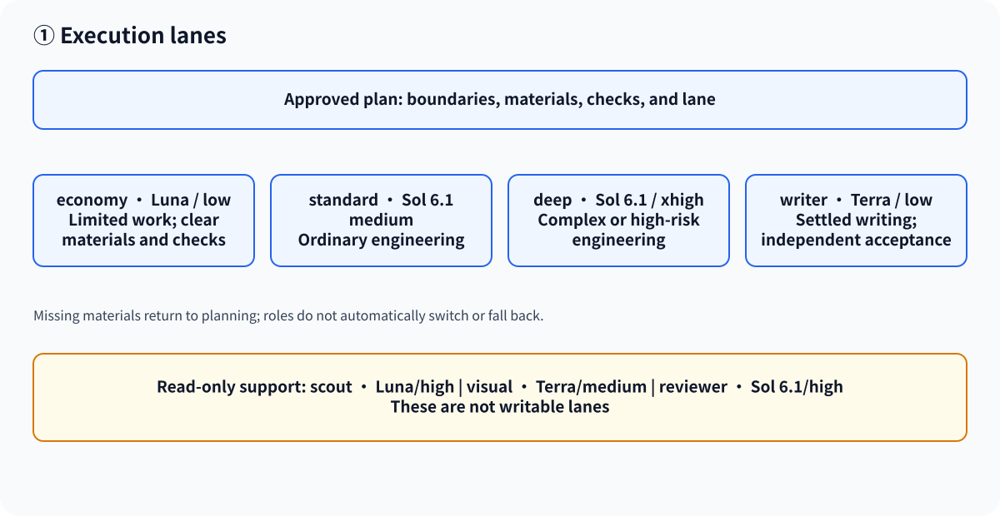
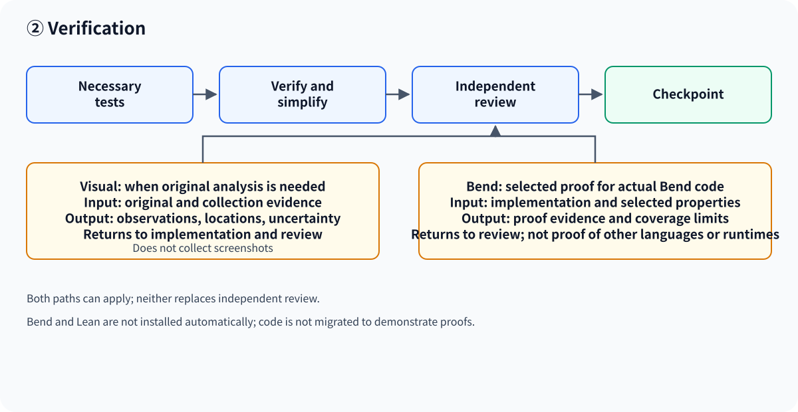

[简体中文](workflow.zh-CN.md) · [README](../README.md)

# Improve workflow

## Overview

Improve is a planning and execution coordination workflow. For a small, clear task, edit directly. For work that needs a reviewed plan, the main path is:

**Clarify and check facts → Review the plan → Authorize → Execute in isolation → Verify and simplify → Independent review → Checkpoint**

A checkpoint is a reviewed, saved commit. Integration and external acceptance are separate steps and require their own authorization and evidence. Planning and review consume usage; they do not guarantee fewer tokens or lower cost.

[① Execution lanes](#execution) · [② Verification](#verification)

Formal planning requires Astra in built-in Plan Mode, with native context management and structured questions actually callable in the current session. An independent Astra plan reviewer may use read-only Default Mode, but also needs both capabilities. A model name, configuration flag, Plan Mode label, or context-window size alone does not establish availability. High reasoning and Code Mode are recommendations. See [configuration](configuration.md#native-codex-configuration) for setup and troubleshooting.

Improve resolves material choices and presents a complete plan in chat without writing files. After the user accepts it and authorizes implementation, a writable phase can save the plan and execute it. Implementation, audits, and routine lifecycle bookkeeping do not require a new formal plan.

## ① Execution lanes

An execution lane is the writable role selected by the approved plan for bounded work. The coordinator snapshots the role for each call; it does not automatically route, switch models, fall back, or replay a started call. Terra is the model used for writing and visual roles.

| Lane | Model / effort | Use when |
|---|---|---|
| economy | Luna / low | A limited task has clear boundaries, materials, and checks. |
| standard | Sol 6.1 / medium | Ordinary engineering work. |
| deep | Sol 6.1 / xhigh | Complex or high-risk engineering work. |
| writer | Terra / low | Writing has settled materials and conclusions and can be accepted independently. |

Writer works offline. If its materials or conclusions are incomplete, return to planning. Atomic code and documentation changes stay with one engineering executor. Scout (Luna/high), visual (Terra/medium), and reviewer (Sol 6.1/high) are read-only supporting roles, not writable lanes. Visual receives original images and collection evidence; its observations go to the plan's named executor and reviewer. See [architecture](architecture.md#executor-routing) for enforcement and [lifecycle ownership](improve-lifecycle.md) for CLI and review constraints.

Examples:

- **Ordinary engineering:** a reviewed plan selects standard, identifies paths and checks, and sends the result to independent review.
- **Settled writing:** a plan supplies writer with facts, conclusions, audience, terminology, paths, and acceptance; missing material goes back to planning.
- **Original image analysis:** visual receives the original and collection evidence, then returns observations with locations and uncertainty to the executor and reviewer.

## ② Verification

The plan chooses verification separately from the execution lane. Run the tests needed for the change, verify and simplify each implementation step, and independently review the candidate. A review and checkpoint bind to the candidate and required evidence; changed inputs can invalidate approval. Permission to review does not itself authorize a commit, integration, push, or publication.

Two conditional paths can both apply:

- **Visual:** when original-image analysis is needed, provide the original and collection evidence. The read-only role returns observations with locations and uncertainty for implementation and review. It does not collect screenshots or replace independent review.
- **Bend:** Bend 2 is a language and tool for formal proofs of selected properties. When the plan selects proof work for an actual Bend implementation, `bend-proof` supplies evidence for specified properties and coverage limits to review. It supplements tests and independent review; it does not prove Rust, compilers, binaries, or the runtime environment. Neither installation automatically installs Bend or Lean, and the workflow does not migrate code to Bend to demonstrate proof capability.
