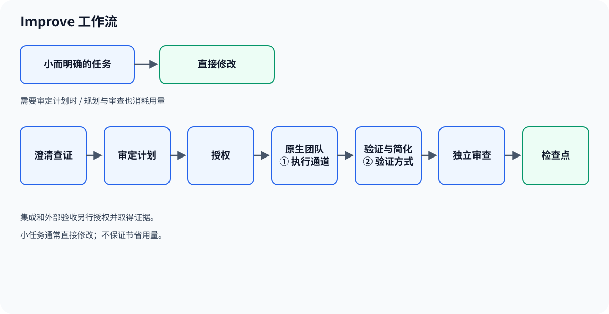

[English](workflow.md) · [README](../README.zh-CN.md)

# Improve 工作流

## 总览

Improve 是协调规划与执行的工作流。小而明确的任务可以直接修改；需要审定计划时，主线是：

**澄清查证 → 审定计划 → 授权 → 隔离执行 → 验证与简化 → 独立审查 → 检查点**

检查点是经审查保存的提交。集成和外部验收是另外的步骤，需要各自的授权和证据。规划和审查也消耗用量，不保证减少 token 或降低费用。

[① 执行通道](#execution) · [② 验证方式](#verification)

正式规划要求 Astra、内置 Plan Mode，以及当前会话中实际可调用的原生上下文管理和结构化提问工具。独立 Astra 计划审查可以使用只读 Default Mode，但同样需要两项能力。模型名称、配置开关、Plan Mode 标识或上下文窗口大小本身都不能证明能力可用。high 推理强度和 Code Mode 是建议。设置及排障见[配置](configuration.zh-CN.md#native-codex-configuration)。

Improve 解决重要选择，在对话中给出完整计划，不写入文件。用户接受计划并授权实现后，可写阶段才能保存并执行计划。实现、审计和普通生命周期记录不需要重新走正式规划流程。

## ① 执行通道

执行通道选择实施根的模型和推理强度。持续连接的客户端读取 canonical roles，继续和修订保持同一个已加载根。派发、通信、等待由原生工具负责；没有模型回退或协调层根计时器。writer 和 visual 使用 Astra。

| 通道 | 模型 / 推理强度 | 适用条件 |
|---|---|---|
| economy | Luna / low | 有限任务的边界、材料和检查明确。 |
| standard | Sol 6.1 / medium | 普通工程任务。 |
| deep | Sol 6.1 / xhigh | 复杂或高风险工程任务。 |
| writer | Astra / xhigh | 写作材料和结论齐备，且可独立验收。 |

writer 需要齐备材料，事实不足返回规划；原子性的代码与文档由同一工程任务交付。scout（Luna/high）与 visual（Astra/xhigh）的只观察是实施团队共享 workspace-write 权限内的职责，不是独立只读沙箱。正式 reviewer（Sol 6.1/high）另起本地只读根，后代继承该边界，并核实外部工具只读能力和图片读取。实施根及后代共享 300k 原生 rollout 单位，正式审查独立 100k；剩余额度提醒分别为 150k/75k/30k 和 50k/25k/10k。这不是上下文长度，也不承诺严格零超额。参见[架构](architecture.md#executor-routing)和[新任务使用](improve-lifecycle.md)。

示例：

- **普通工程：**审定的计划选择 standard，列出路径和检查，然后将结果交给独立审查。
- **定稿写作：**计划向 writer 提供事实、结论、读者、术语、路径和验收条件；材料不足则返回规划。
- **原图分析：**visual 接收原图和收集证据，向执行器与审查员返回带位置和不确定性的观察。

## ② 验证方式

计划分别选择验证方式和执行通道。运行改动所需的测试，逐步验证并简化实现，再对候选版本进行独立审查。审查和检查点绑定候选版本及所需证据；输入变化可能使批准失效。审查权限本身不授予提交、集成、推送或发布权限。

两条有条件的支线可以同时适用：

- **视觉：**需要分析原图时，提供原图及收集证据。观察角色返回带位置和不确定性的观察，供实现和审查使用；它不负责收集截图，也不替代独立审查。
- **Bend：**Bend 2 是对选定性质做形式证明的语言与工具。计划为实际 Bend 实现选择证明工作时，`bend-proof` 向审查提供指定性质的证据和覆盖边界。它补充测试与独立审查，不证明 Rust、编译器、二进制或运行环境。两种安装方式均不自动安装 Bend 或 Lean，也不会为了展示证明能力而迁移代码。
