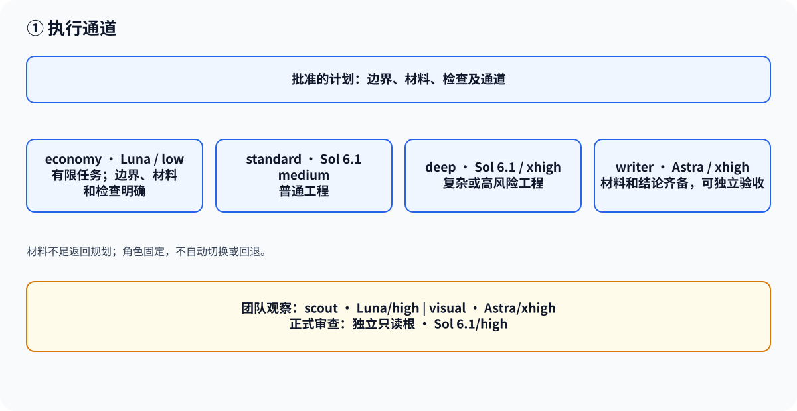
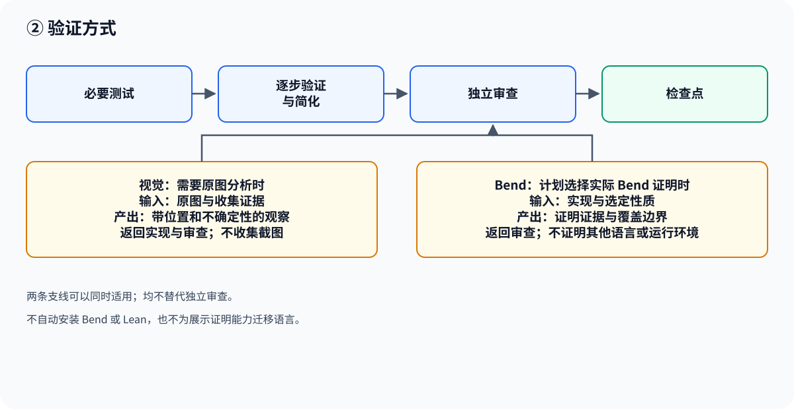

[English](workflow.md) · [README](../README.zh-CN.md)

# Improve 工作流

## 总览

Improve 是协调规划与执行的工作流。小而明确的任务可以直接修改；需要审定计划时，主线是：

**澄清查证 → 审定计划 → 授权 → 隔离执行 → 验证与简化 → 独立审查 → 检查点**

检查点是经审查保存的提交。集成和外部验收是另外的步骤，需要各自的授权和证据。规划和审查也消耗用量，不保证减少 token 或降低费用。

[① 执行通道](#execution) · [② 验证方式](#verification)

正式规划的目标为 `gpt-6.2-astra`、`xhigh` 推理强度和内置 Plan Mode。独立计划审查使用相同模型和推理强度，可以使用只读 Default Mode。两者都要求直接暴露的原生 `new_context`、可调用的 `get_context_remaining`，以及当前模式可用的结构化提问工具。核对可信的模型／推理强度／模式元数据和实际工具，包括嵌套目录；嵌套目录没有直接条目，不能据此认定工具缺失。只核对可用性，不主动切窗测试。模型名称、配置开关或上下文窗口大小本身都不够。前提缺失或未经确认时，正式规划为 BLOCKED；普通 Plan Mode 仍可给出草案。仅用户主动选择时才可临时使用旧代 Astra，且须满足同样的模式和能力要求；不自动切换。Code Mode 仍是建议。排障见[配置](configuration.zh-CN.md#native-codex-configuration)。

Improve 解决重要选择，在对话中给出完整计划，不写入文件。用户接受计划并授权实现后，可写阶段才能保存并执行计划。实现、审计和普通生命周期记录不需要重新走正式规划流程。

## ① 执行通道

执行通道选择实施根的模型和推理强度。持续连接的客户端读取 canonical roles，继续和修订保持同一个已加载根。派发、通信、等待由原生工具负责；没有模型回退或协调层根计时器。Sol 6.2 指 `gpt-6.2-sol`，Astra 6.2 指 `gpt-6.2-astra`，Luna 指 `gpt-6-luna`。全部角色使用 medium verbosity。

| 通道 | 模型 / 推理强度 | 适用条件 |
|---|---|---|
| economy | Luna / low | 有限任务的边界、材料和检查明确。 |
| standard | Sol 6.2 / medium | 普通工程任务。 |
| deep | Sol 6.2 / xhigh | 复杂或高风险工程任务。 |
| writer | Astra 6.2 / xhigh | 写作材料和结论齐备，且可独立验收。 |

writer 仅在事实缺失或冲突阻止准确成稿时，停止受影响工作并说明缺口；原子性的代码与文档由同一工程任务交付。scout（Sol 6.2/medium）返回来源及未解决的证据缺口。scout 与 visual（Astra 6.2/xhigh）的只观察是实施团队共享 workspace-write 权限内的职责，不是独立只读沙箱。正式 reviewer（Astra 6.2/high）另起本地只读根，后代继承该边界，并核实外部工具只读能力和图片读取。实施根及后代共享 300k 原生 rollout 单位，正式审查独立 100k；剩余额度提醒分别为 150k/75k/30k 和 50k/25k/10k。这不是上下文长度，也不承诺严格零超额。参见[架构](architecture.md#executor-routing)和[新任务使用](improve-lifecycle.md)。

示例：

- **普通工程：**审定的计划选择 standard，列出路径和检查，然后将结果交给独立审查。
- **定稿写作：**计划向 writer 提供事实、结论、读者、术语、路径和验收条件；仅在事实缺失或冲突阻止准确成稿时，停止受影响工作并说明缺口。
- **原图分析：**visual 接收原图和收集证据，向执行器与审查员返回带位置和不确定性的观察。

## ② 验证方式

计划分别选择验证方式和执行通道。运行改动所需的测试，逐步验证并简化实现，再对候选版本进行独立审查。审查和检查点绑定候选版本及所需证据；输入变化可能使批准失效。捕获前须确认所有后代和后台终端停写；独立审查期间保持实施根加载。连接或根丢失即停止，不重开预算。审查权限本身不授予提交、集成、推送或发布权限。

READY 前，在现有独立计划审查中走通最难验收的完整链路：操作者权限 → 固定输入 → 产物与候选绑定 → 失败处理 → 最终判断人。先完成生成，确认所有代理和终端停写，再捕获候选，在冻结的 Git 工作区检查同步，然后导出，在候选之外构建／测试。捕获前打包的产物须有输入未变的绑定证据，否则从导出候选重建。自举升级要区分已安装工具及其权限与候选交付能力，本次运行的可执行程序、协调器和角色保持固定；不能依赖候选补齐验收自身所需的缺失能力。

涉及模型运行的行为，选择源码／配置、既有事件、静态场景、离线协议夹具和不调用模型的构建作为证据。不专门启动消耗订阅额度的 A/B、smoke、真实子代理、端到端、预算耗尽或 prompt 试验。实际运行只在原本要做的正常工作中观察，未观察项记录为 `NOT RUN`。其他可验证工作仍可继续，必需能力和门禁仍须各自满足证据要求。写清停写流程，不等于已观察到真实终止。

审查恰好覆盖 `scope` 与计划要求的证据编号；只有计划明确声明的延期验收可以待完成。原生已确认 failed/interrupted，且结果为 budget_exhausted、timed_out、cancelled 或 failed 的实施回合，也可以送审，但仍须核实连接、同一已加载根、全部写入者和后台终端停写、候选及修改范围有效、必需检查证据当前有效且 PASS。unknown、仍运行、完成但报告无效及执行器返回 STOPPED 均不放行。只有正常完成、报告有效且输入未变的独立 APPROVE 才授予批准。

失败回合和主动取消均保留有大小上限的原文、解析后的报告、诊断、原生状态与错误及最后已知用量。取消不授予批准；缺少终态确认或可信最终计量时，明确保留未知。再次审查时，`dossier.notes` 按已核实事实及出处、待独立判断的问题、候选或输入变化组织。新审阅员接收当前已校验的证据和紧邻上一轮的诊断快照，独立作出判断。详见[连接式工作流](../src/improve/references/closing-the-loop.md)。

两条有条件的支线可以同时适用：

- **视觉：**需要分析原图时，提供原图及收集证据。观察角色返回带位置和不确定性的观察，供实现和审查使用；它不负责收集截图，也不替代独立审查。
- **Bend：**Bend 2 是对选定性质做形式证明的语言与工具。计划为实际 Bend 实现选择证明工作时，`bend-proof` 向审查提供指定性质的证据和覆盖边界。它补充测试与独立审查，不证明 Rust、编译器、二进制或运行环境。两种安装方式均不自动安装 Bend 或 Lean，也不会为了展示证明能力而迁移代码。
